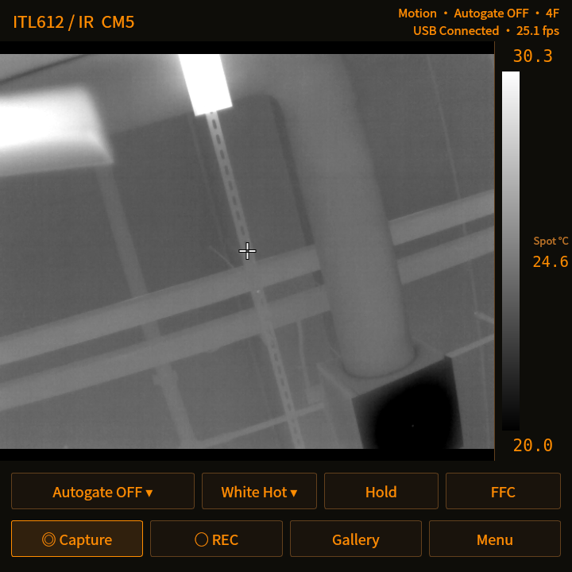
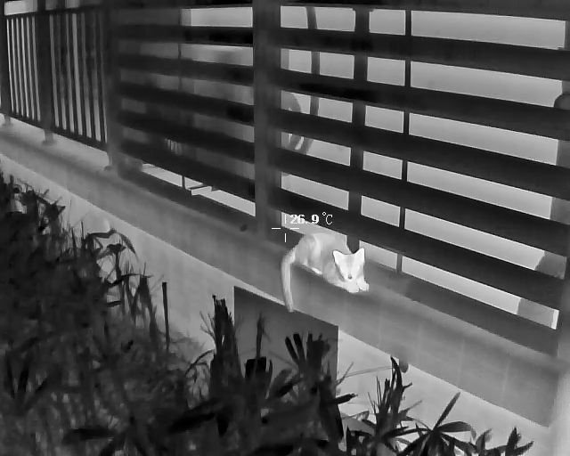

# ITL612 Thermal for Raspberry Pi CM5

[简体中文](README.md) | [English](README.en.md)

ITL612 Thermal 是面向 Raspberry Pi CM5 的 640×512 热像应用，支持 ITL612 Pro（Mars）USB 机芯、RAW16 实时处理、运动补偿多帧降噪、Autogate 自适应映射和机芯温度标记。提供中英界面、三种主题、拍照与录像，针对 Hackberry Pi 的 720×720 方屏设计。

本项目使用的掌机硬件基于 **[ZitaoTech / HackberryPiCM5](https://github.com/ZitaoTech/HackberryPiCM5)** 项目：搭载 Raspberry Pi CM5、720×720 触摸屏与 BlackBerry 键盘的便携 Linux 设备。感谢该项目提供硬件设计和使用文档；本仓库提供配合 ITL612 Pro USB 热像机芯使用的应用软件。

[下载 ARM64 .deb](https://github.com/paclab2026/itl612-cm5/releases/download/v0.1.0/itl612-cm5_0.1.0_arm64.deb) · [v0.1.0 Release](https://github.com/paclab2026/itl612-cm5/releases/tag/v0.1.0)

## 界面与外拍演示

### CM5 主界面



720×720 CM5 实机截图，使用 Deep Amber 皮肤和英文界面。状态位于右上角；温度色条位于画面右侧；下方提供 Autogate、伪色、锁窗、FFC、拍照、录像、文件和菜单入口。

### 猫咪外拍



从既有 ITL612 Pro（Mars）机芯外拍视频选取的一帧，保留 640×512 原尺寸与原有显示效果，可观察猫脸、耳朵、身体与周围植被、栏杆的热对比。此片段由早期 Apple 端应用录制，用于展示同款机芯的实际成像；不是 CM5 录制或 CM5 帧率测试。图片未经生成式处理、超分辨率或额外锐化；图中温度文字是原视频叠加信息，不代表独立标定结果。

## 已验证环境

已验证：CM5 8GB、720×720 显示屏、Raspberry Pi OS Bookworm 64 位、Mars USB `04b4:f7f7`。其他机芯、系统版本和树莓派型号尚未验证。机芯输入约 30 Hz；增强预览帧率取决于配置；MP4 为 25 fps。

## 安装 Debian 包

在树莓派桌面系统中运行：

```sh
sudo apt install ./itl612-cm5_0.1.0_arm64.deb
```

重插机芯，从应用菜单打开 **ITL612 热像**。包会安装程序、启动器、着色器、图标与专用 USB 权限规则，不设置开机自启动。程序为 `/usr/bin/itl612-cm5`，启动器为 `/usr/bin/itl612-start`。

首次启动选择 **中文 / ENG**。以后可在 **菜单 → 语言/lang** 切换，立即生效。关闭首次选择窗会退出程序。配置保存在 `~/.config/ITL612/CM5.conf` 的 `ui/language`（`zh` 或 `en`），遵循 `XDG_CONFIG_HOME`；升级保留。旧版本第一次升级后也会询问语言。

## 从源码安装

在本目录运行；安装脚本以普通桌面用户执行：

```sh
sudo apt install --no-install-recommends cmake g++ make pkg-config \
  libusb-1.0-0-dev qt6-base-dev libqt6opengl6-dev qt6-wayland \
  libegl-dev libgles-dev ffmpeg fonts-noto-cjk xdg-user-dirs desktop-file-utils
sh install.sh
sudo install -m 0644 70-itl612-mars.rules /etc/udev/rules.d/
sudo udevadm control --reload-rules
```

重插机芯后，用桌面图标或 `~/.local/bin/itl612-start` 启动。不要以 root 运行界面。

## 制作安装包

在目标架构、目标发行版上安装上述构建依赖，再运行：

```sh
sudo apt install dpkg-dev
sh packaging/build-deb.sh
```

输出为 `build-deb/itl612-cm5_0.1.0_arm64.deb`。依赖由实际二进制自动分析，程序使用系统 Qt、Mesa 和 FFmpeg。运行 `python3 packaging/make-source.py build-deb` 可生成独立源码包；构建产物和本机开发脚本不进入源码包。

## 常用操作

- **Autogate 开／关**：自适应／线性显示映射；降噪模式独立设置。
- **运动自适应／常规多帧**：运动补偿／常规时域降噪；支持单帧、4 帧、8 帧。
- **锁窗／Hold**：固定显示范围；**校正／FFC**：请求机芯快门校正。
- **测温**：中心点、最高／最低温标记、伪色色条。温度来自机芯参数；色条不是线性温度标尺。
- **拍照／录像／文件**：照片与视频保存在系统图片目录下的 `thermal/`，遵循系统目录本地化。
- **皮肤**：白色、黑灰、Deep Amber；**语言/lang**：中文／ENG。
- **退出应用**：完成录像并退出进程。菜单中 Esc 返回主界面，主界面 Esc 退出。

应用不采集或录制 RAW 文件，不生成 RAW 临时媒体；传感器数据仅用于内存中的实时处理。未提供逐像素测温标定、ROI 测温或深度模型。

## 排障与卸载

找不到机芯时，用 `lsusb` 检查 `04b4:f7f7`，安装权限规则后重插设备，并退出其他占用机芯的程序。录像需要 FFmpeg，播放使用 ffplay。拍摄要求剩余空间至少 200 MB。着色器数据缓存位于 `~/.cache/itl612-cm5`，数据上限 16 MiB，索引另有少量开销。

Qt 6.4 在 DISPLAY 可用时默认使用经 XWayland 的硬件 EGL，这是实机验证过的兼容配置。应用不接管温控，不按温度限帧。

用 `sudo apt remove itl612-cm5` 卸载包；个人配置和照片录像保留。旧的用户目录安装会优先于系统安装，迁移时需先移走旧的本地启动器及同名应用菜单入口。

## 开发测试

常规安装包默认不包含测试、基准和界面审计入口。需要开发检查时配置 `-DBUILD_TESTING=ON -DBUILD_TOOLS=ON`；`ctest --test-dir <构建目录>` 运行测温绘制检查。应用正常构建不依赖 Apple 项目、模型权重或外拍素材。
